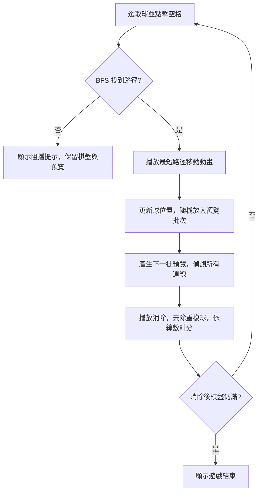

# 點陣方圓大對決（Dot & Crown）

以原生 JavaScript ES Modules、HTML、CSS 製作的五連線策略遊戲。UI、棋盤資料、球元素、遊戲規則與動畫分開管理，沒有執行期套件或後端服務。

- 線上入口：<https://m80ta.github.io/dotdotgame/>
- 原始碼：<https://github.com/M80ta/dotdotgame>
- 目前提供「遊戲 A」，右上角保留「遊戲 B」選項，尚未開放。

## 本機啟動

需要 Node.js 20 以上；GitHub Actions 使用 Node.js 24。沒有外部套件，不必執行 `npm install`。

```powershell
npm start
```

開啟 <http://127.0.0.1:4173>。也可用 Python 啟動：

```powershell
python -m http.server 4173 --bind 127.0.0.1
```

請透過 HTTP 開啟 `index.html`。ES Modules 需要正確的來源與 JavaScript MIME，直接雙擊 HTML 的 `file://` 開啟方式不適用。舊入口 `dot_and_crown_fixed.html` 會轉到 `index.html`。

## 遊戲 A 規則

1. 棋盤可選擇 8 × 8、9 × 9、10 × 10。
2. n 預設 3，可改為 4 或 5。開局在不重複的隨機位置產生 n 顆球。同一批球的顏色互不相同，從紅、藍、綠、黃、紫五色抽取。
3. 點擊／輕觸既有的球即可選取，選取球會輕微跳動；再次點同一顆球會取消，點另一顆會切換選取。
4. 選取後點擊空格，棋盤以 BFS 搜尋上下左右的最短路徑。不能斜向移動，也不能穿過其他球。沒有路徑時保留選取，不新增球、不消耗預覽。
5. 成功移動後，**每回合都會**將上方預覽的 n 顆球放到隨機空格，並產生新的預覽。即使移動已形成連線，仍先補球再統一判定消除。
6. 橫向、直向、左上至右下、右上至左下，任一方向連續同色球達 5 顆以上，即整條消除。六顆以上的連續球算一條線，不拆成多個五連線。
7. 單次得分 = **實際消除的不重複球數 × 同時完成的連線數**。例如一條五連線得 5 分；兩條交叉五連線共有 9 顆，得到 9 × 2 = 18 分；兩條不相交五連線得到 10 × 2 = 20 分。
8. 消除後保留其他球的位置，沒有重力掉落。
9. 空格不足 n 個時，先填入剩餘空格，再執行消除。消除後棋盤仍滿才結束；當回合放不下的預覽球不保留到下一回合。

變更 n 時保留目前棋盤、分數、選取球及預覽前段，從尾端補足或縮短。變更棋盤大小或按「重新開始」會開始新局。最高分儲存在目前瀏覽器的 `localStorage`，不會同步到其他裝置；儲存遭封鎖時仍可正常遊玩。

## 目錄與模組責任

```text
index.html                       網頁結構與無障礙標記
dot_and_crown_fixed.html          舊入口轉址
src/
  main.js                        建立並組合各模組，啟動遊戲
  config.js                      尺寸、n、連線門檻、方向、儲存鍵值
  board/
    board.js                     棋盤資料、隨機空格、BFS、移動與清除
    board-view.js                棋盤 DOM、選取樣式、滑鼠／觸控／鍵盤輸入
  elements/
    ball.js                      顏色、批次亂數、共用球元素工廠
  game/
    game-a.js                    遊戲 A 狀態與回合規則，無 DOM 相依
    lines.js                     四方向連線偵測、交叉去重與線數計算
    controller.js                協調回合、動畫、UI 與最高分
  ui/
    game-ui.js                   設定、預覽、計分、王座與結束視窗
    ball-animator.js              選定路徑的史萊姆動畫與消除動畫
  services/
    high-score.js                隔離瀏覽器儲存與例外處理
styles/
  base.css                       色彩、字體、全域基礎樣式與焦點
  layout.css                     頁面、側欄、設定列與主面板配置
  ui.css                         控制項、王座、分數、預覽與彈窗
  board.css                      流式方形棋盤與格子
  elements.css                   球的顏色與動畫
  responsive.css                 手機、平板及橫向短螢幕版面
scripts/
  serve.mjs                      本機靜態伺服器
  build.mjs                      以允許清單產生 dist/ 靜態網站
tests/                           規則、UI 整合、非同步競態與靜態資源測試
.github/workflows/pages.yml       測試、建置、GitHub Pages 部署
LICENSE.md                       授權全文
```

依賴方向：`main → controller → GameA / Board / UI / Animator / Store`。`GameA`、`Board`、連線偵測不讀取 `document`、不操作 DOM，也不等待動畫，可在 Node.js 直接測試。UI 只呈現狀態；合法移動、隨機補球、消除與得分由遊戲規則決定。

## 回合資料流程



`GameController` 在每次重新開始時增加回合版本並取消進行中的移動動畫。每個非同步階段完成後都檢查版本，避免舊局的動畫或延遲改動新局，也避免連點觸發重複移動。

## 裝置與操作

| 可用視窗寬度 | 版面 |
| --- | --- |
| 320–600 px 手機 | 國王面板、棋盤、挑戰者面板依序排列；按鈕及設定可換行 |
| 601–1023 px 平板／窄筆電視窗 | 兩個側欄並排在上，棋盤置中於下 |
| 1024 px 以上筆電／桌機 | 左右王座與中央棋盤三欄排列 |

棋盤以容器寬度與等比例 CSS Grid 縮放，8／9／10 格都不使用固定格寬。橫向或短螢幕可自然垂直捲動；支援瀏海安全區，避免以裁切內容掩蓋溢出。

- 滑鼠與觸控使用相同選球、選目標操作，不要求拖曳。
- 設定與主要按鈕至少 44 px 高，選單字體避免手機自動放大。
- 鍵盤可用 Tab 移入格子、方向鍵切換格子，Enter／空白鍵選球或移動。
- 遵循 `prefers-reduced-motion`，降低動態效果時跳過跳動與移動動畫。
- 目標為支援 ES Modules、CSS Grid、`aspect-ratio` 與 Web Animations API 的現代 Chrome、Edge、Safari、Firefox。

## 測試與建置

```powershell
npm test
npm run build
node scripts/serve.mjs --dir dist --port 4174
```

測試涵蓋設定組合、最短路徑與阻擋、整批補球、四方向消除、長連線、交叉 Combo、滿盤、動畫中重新開始、UI／鍵盤、儲存失敗，以及 ES Modules 相對路徑與 HTTP MIME。DOM 整合測試使用輕量替身；不等同各實體裝置的瀏覽器測試。

`dist/` 只包含遊戲入口、`src/`、`styles/`、舊入口與說明／授權，不會上傳 `.git/`、測試、開發快取或環境檔。`dist/` 是自動產物，不提交到 Git。

## GitHub Pages

儲存庫使用 `main` 分支。首次設定在 GitHub 的 **Settings → Pages → Build and deployment → Source** 選擇 **GitHub Actions**。

每次推送 `main`，`.github/workflows/pages.yml` 會依序執行測試、建置、上傳 `dist/` 與部署。Pull Request 僅驗證，不部署；亦可在 Actions 手動執行。部署結果可在儲存庫的 Actions／Deployments 查看。

所有 CSS／JavaScript 都使用相對路徑，可在 `https://m80ta.github.io/dotdotgame/` 的專案子路徑正常載入。

## 後續新增遊戲 B

在 `src/game/` 新增獨立規則模組，再由 Controller 選擇對應遊戲；可共用 `Board`、`BoardView`、球元素與 UI。完成對應規則與測試後，再開放右上角遊戲 B 選項。

## 授權

本專案採用 [PolyForm Noncommercial License 1.0.0](LICENSE.md)。

- 允許為非商業目的使用、複製、修改及分享，包括個人娛樂、學習與實驗。
- 分享原始檔或修改版時，必須保留授權全文或其官方網址，以及 `Required Notice:` 著作權聲明。
- 超出本授權允許用途的商業使用，例如販售、付費服務、廣告營利或商業產品整合，須先取得著作權人另外的書面許可。
- 官方條款亦列明慈善組織、教育機構、公共研究機構及政府機構等組織的允許用途；完整範圍與條件以 [LICENSE.md](LICENSE.md) 英文全文為準。

Required Notice: Copyright (c) 2026 M80ta

商業授權需求請聯絡專案維護者 [M80ta](https://github.com/M80ta)。
