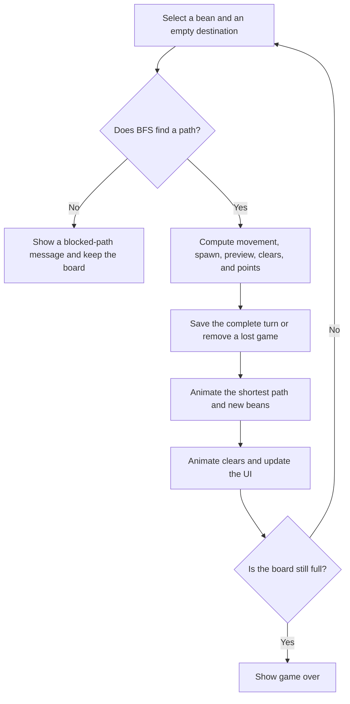

# Nini's Bean Battle

**English** | [繁體中文](./README.zh-TW.md)


A five-in-a-row strategy game built with native JavaScript ES Modules, HTML, and CSS. Move colorful beans around obstacles, complete matching lines, and challenge the reigning king. The UI, board data, bean elements, game rules, animation, and storage are separate modules. No runtime packages or backend are required.

- **Play:** <https://m80ta.github.io/dotdotgame/>
- **Short link:** <https://is.gd/QpkZPm>
- **Source:** <https://github.com/M80ta/dotdotgame>
- **Modes:** Game A is playable. Game B is reserved in the menu and is not available yet.

## Languages

Use **Language / 語言** at the top right to switch between **English** and **繁體中文**. Menus, instructions, scores, game-over dialogs, preview descriptions, and board accessibility labels are translated.

On the first visit, Chinese browser locales use Traditional Chinese; other browser locales use English. A saved language choice takes precedence on subsequent visits. Switching languages preserves the board, score, settings, selection, preview, and active animation. Language preferences are stored separately from game progress, so restarting or losing does not reset the language. Existing saves with Chinese-only status messages remain compatible.

GitHub uses this English `README.md` as the main project description. [README.zh-TW.md](./README.zh-TW.md) contains the complete Traditional Chinese version.

## Sound effects

- Selecting or deselecting a bean plays a short spoken **“豆” (dòu)** cue in either language.
- Moving plays a gentle, low-pitched slime drag sound that stops when the movement ends.
- Clearing plays a short cluster of soft bubble pops, with a volume limit for large combos.

Sound is on by default. The **Sound on / Sound off** button at the top remembers the choice in this browser, separately from the game save and language. Muting, restarting, changing game settings, or leaving/backgrounding the page stops active and pending sounds. Returning to the page does not replay old effects.

`GameAudio` uses one Web Audio context, created or resumed from a player action in accordance with [browser autoplay guidance](https://developer.mozilla.org/en-US/docs/Web/API/Web_Audio_API/Best_practices#autoplay_policy). The Chinese cue is bundled as a small WAV; drag and pop waveforms are generated locally. There is no runtime speech service or extra package. Unavailable audio, failed downloads, or blocked playback leave the game playable. Device volume, silent mode, and browser settings can affect audibility.

## Run locally

Use Node.js 20 or later. GitHub Actions uses Node.js 24. There are no external dependencies, so `npm install` is unnecessary.

```powershell
npm start
```

Open <http://127.0.0.1:4173>. You can also use Python:

```powershell
python -m http.server 4173 --bind 127.0.0.1
```

Serve `index.html` over HTTP. ES Modules need a valid origin and JavaScript MIME type; opening the HTML directly with `file://` is not supported. The previous entry, `dot_and_crown_fixed.html`, redirects to `index.html`.

## Game A rules

1. Choose an **8 × 8**, **9 × 9**, or **10 × 10** board.
2. The number of new beans per turn, **n**, defaults to **3** and can be **4** or **5**. A new game places n beans in distinct random cells. Each batch contains distinct colors drawn from red, blue, green, yellow, and purple.
3. Click or tap an existing bean to select it. The selected bean gently bounces. Select it again to cancel, or select another bean to change the selection.
4. Select an empty destination. Breadth-first search finds the shortest path through empty cells using up, down, left, and right moves. Beans cannot move diagonally or pass through other beans. An unreachable destination leaves the board and preview unchanged and retains the selection.
5. **Every successful move adds the entire preview batch** to random empty cells and generates a new preview. New beans are added before all completed lines are checked, even when the move itself creates a line.
6. A continuous line of **five or more beans of the same color** clears horizontally, vertically, or along either diagonal. A longer run counts as one line, not several overlapping five-bean lines.
7. **Points = unique beans cleared × lines completed simultaneously.** One five-bean line earns 5 points. Two crossing five-bean lines contain 9 unique beans and earn 9 × 2 = 18 points. Two separate five-bean lines earn 10 × 2 = 20 points.
8. Other beans stay in place after a clear. There is no gravity.
9. If fewer than n empty cells remain, fill the available cells and then check for clears. The game ends only if the board is still full after clearing. Beans that did not fit are not carried into the next turn.

**Changing the board size or n, selecting Restart game, or selecting Play again starts a new game.** The score, selection, and combo reset; the chosen settings determine the initial beans and new preview. The high score is preserved. Changing the language does not restart the game.

## Saving and resuming

An unfinished game is saved immediately to `localStorage` in the current browser on the current device. Refreshing or reopening the same website restores the board, board size, n, preview, score, selection, combo, and status message. Progress is not uploaded to a server or synchronized across devices or browsers.

- Selection changes and valid moves are saved synchronously; saving does not depend on a tab-close event.
- Each accepted move computes movement, random placement, clearing, and scoring before atomically saving the complete result. Animations present that result afterward. Refreshing during an animation resumes the completed turn without adding another batch or drawing new colors.
- Restarting or changing a game setting replaces the previous save with a new game. Losing removes that game's save, so refreshing starts a new game.
- The high score has a separate record and survives restarts and losses.
- Saves are versioned and validated. Invalid dimensions, colors, data formats, and already-full boards are rejected without breaking startup.
- Status codes and numeric parameters allow the same save to be displayed in either language. Older saves containing Chinese messages are migrated without discarding the game.
- Clearing browser site data, or using a browsing mode that cannot retain it, affects saved progress. If storage is blocked or a write fails, the game remains playable and displays a message explaining that progress cannot be saved.

## Project structure

```text
README.md                        Main English documentation
README.zh-TW.md                  Traditional Chinese documentation
index.html                       Page structure and accessibility markup
dot_and_crown_fixed.html          Redirect from the previous entry
assets/
  doudou-icon.png                 Original generated bean icon
  doudou-icon-{32,180,512}.png     Tab, home-screen, and sharing icons
  doudou.ico                      Multi-resolution browser icon
  audio/dou.wav                   Short bundled Chinese selection cue
  README.md                       Icon usage and generation prompt
src/
  main.js                        Compose the modules and start the app
  config.js                      Sizes, line threshold, directions, storage keys
  audio/
    sound-effects.js             Gentle drag-loop and bubble-pop waveforms
  board/
    board.js                     Board data, empty cells, BFS, movement, clearing
    board-view.js                Board DOM, selection, mouse/touch/keyboard input
  elements/
    ball.js                      Color IDs, random batches, shared bean elements
  game/
    game-a.js                    Game A state and turn rules, without DOM access
    lines.js                     Four-direction detection and crossing deduplication
    controller.js                Coordinate turns, animation, UI, and persistence
    status.js                    Language-neutral status codes and legacy saves
  i18n/
    messages.js                  English and Traditional Chinese dictionaries
    translator.js                Language preference, formatting, page localization
  ui/
    game-ui.js                   Settings, preview, scores, towers, dialogs
    ball-animator.js              Slime-like movement and clearing animations
  services/
    game-audio.js                Audio playback, cancellation, mute preference
    high-score.js                High-score storage and error handling
    game-session.js              Versioned device-local game saves
styles/
  base.css                       Colors, typography, global styles, focus
  layout.css                     Header controls, sidebars, settings, main panel
  ui.css                         Controls, towers, scores, preview, dialogs
  board.css                      Fluid square board and cells
  elements.css                   Bean colors and animation
  responsive.css                 Phone, tablet, and short landscape layouts
scripts/
  serve.mjs                      Local static server
  build.mjs                      Build dist/ using an explicit allowlist
tests/                           Rules, UI, persistence, language, static assets
.github/workflows/pages.yml       Tests, build, and GitHub Pages deployment
LICENSE.md                       Full license text
```

Dependencies flow from `main` to the controller, game, board, UI, animator, and storage. `GameA`, `Board`, and line detection do not access `document` or wait for animation and can be tested directly in Node.js. The UI presents state; the rules decide legal moves, placement, clearing, and points. Translation dictionaries and language preferences are separate from the game rules.

## Turn flow



`GameController.start()` restores a valid device-local save before deciding to create a new game. `GameA.toSnapshot()` and `fromSnapshot()` handle restorable rule state; `GameSessionStore` handles versioned storage. The restored state updates both the settings and the board.

Restarting increments the controller version and cancels active movement. Every asynchronous stage checks that version before continuing, so an old animation cannot modify a new game or overwrite its save. Both game settings can interrupt animation and start a fresh game. Language changes update the displayed text and accessibility labels in place, leaving the current turn intact.

## Devices and controls

| Viewport width | Layout |
| --- | --- |
| 320–600 px: phones | King panel, board, then challenger panel; controls wrap |
| 601–1023 px: tablets or narrow laptop windows | Both side panels above a centered board |
| 1024 px and above: laptops and desktops | Left throne, central board, right throne |

The square CSS Grid board scales with its container for all three board sizes. Short or landscape screens can scroll vertically. Safe-area padding supports notched displays; content is not clipped to hide overflow.

- Mouse and touch share the same select-then-destination interaction; dragging is not required.
- Settings and primary buttons are at least 44 px tall. Select font sizes avoid automatic mobile zoom.
- Use Tab to focus a cell, arrow keys to navigate, and Enter or Space to select or move.
- `prefers-reduced-motion` skips bouncing and movement animation.
- The target browsers are modern Chrome, Edge, Safari, and Firefox with ES Modules, CSS Grid, `aspect-ratio`, and Web Animations API support.

### Previous browser layout checks

Before the language selector was added, the deployed game was checked in Windows Chrome's Responsive device emulation:

| Emulated viewport | Checked |
| --- | --- |
| 320 × 900 | Phone layout, 8 × 8 and 10 × 10 boards, 3 and 5 preview beans, wrapping settings |
| 768 × 1024 | Tablet layout, two upper side panels, centered 10 × 10 board, 5-bean preview |
| 1366 × 768 | Laptop layout, three columns, 10 × 10 board, 5-bean preview, vertical scrolling |

These checks found no horizontal overflow, and selecting, moving, and spawning beans were exercised on the live game. This is Chrome emulation, not testing on every physical iPhone/iPad or in Safari/Firefox.

The bilingual interface is covered by automated DOM integration tests. Its updated layout still needs visual verification in a browser.

## Tests and build

```powershell
npm test
npm run build
node scripts/serve.mjs --dir dist --port 4174
```

Tests cover settings, shortest paths, blocked moves, batch spawning, all line directions, long lines, crossing combos, full boards, reload recovery, refresh/restart during animation, settings resets, corrupt saves, storage failures, keyboard input, language switching, legacy save compatibility, relative ES Module imports, and HTTP MIME types. DOM integration tests use lightweight doubles and do not replace real-device browser testing.

Audio tests additionally cover gesture-based startup, sound timing, stopping old turns, backgrounding, mute persistence, failed audio/storage, waveform bounds, and WAV format. Audio API doubles verify scheduling and cleanup; actual speaker loudness and device silent-mode behavior still need listening checks on target devices.

`dist/` contains only the game entries, `src/`, `styles/`, `assets/`, both READMEs, and the license. Git data, tests, development caches, and environment files are excluded. Build output is ignored by Git.

## GitHub Pages

The repository uses `main`. For the first deployment, set **Settings → Pages → Build and deployment → Source** to **GitHub Actions**.

Every push to `main` runs tests, builds the static site, uploads `dist/`, and deploys it through `.github/workflows/pages.yml`. Pull requests validate without deploying. The workflow can also be run manually. Results appear in Actions and Deployments.

All CSS and JavaScript paths are relative, so the game works under the project path at <https://m80ta.github.io/dotdotgame/>.

## Adding Game B

Create a separate rules module in `src/game/` and have the controller select the appropriate game. Reuse `Board`, `BoardView`, bean elements, and UI where applicable. Enable Game B in the menu only after its rules and tests are ready.

## License

This project uses the [PolyForm Noncommercial License 1.0.0](./LICENSE.md).

Noncommercial use, copying, modification, and sharing are permitted under its terms. Preserve the license text or its official URL and the required copyright notice when redistributing the original or a modified version. Commercial uses outside the license's permitted purposes require separate written permission. The full English text in `LICENSE.md` governs the scope and conditions, including the listed permitted organizational uses.

Required Notice: Copyright (c) 2026 M80ta

For commercial licensing, contact the project maintainer [M80ta](https://github.com/M80ta).
