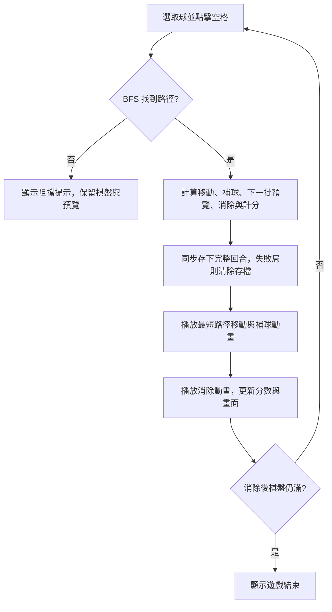

# 妮妮的豆豆大戰

[English](./README.md) | **繁體中文**


以原生 JavaScript ES Modules、HTML、CSS 製作的五連線策略遊戲。UI、棋盤資料、球元素、規則、動畫與儲存分開管理。單機遊玩不需要執行期套件或後端；共享排行榜使用 Supabase。

- 線上入口：<https://m80ta.github.io/dotdotgame/>
- 原始碼：<https://github.com/M80ta/dotdotgame>
- 目前提供「遊戲 A」，右上角保留「遊戲 B」選項，尚未開放。

## 語言切換

遊戲右上角提供「繁體中文／English」切換，包含選單、提示、計分、結束視窗、棋盤與預覽的無障礙標籤。第一次開啟時依瀏覽器語言選擇介面：中文瀏覽器使用繁體中文，其他語言使用英文；之後優先使用裝置已記住的選擇。

切換語言不會重新開局、不會重新抽球，也不會中斷進行中的動畫。語言偏好與對局進度分開儲存，重來或失敗不會清除語言選擇。原有僅保存中文提示的存檔可繼續使用，提示會轉為目前選取的語言。

GitHub 預設顯示英文 `README.md`，本檔 `README.zh-TW.md` 保留完整繁體中文說明，兩者互相連結。

## 遊戲音效

- 點選或取消選取豆豆：短促的「豆」語音，中英文介面皆相同。
- 豆豆移動：溫和、偏低音的史萊姆拖曳聲，移動結束即停止。
- 消除連線：短促的泡泡破裂聲；大量消除時限制同時音量。

音效預設開啟，右上角「音效開啟／音效關閉」按鈕會記住目前瀏覽器的選擇，與對局、語言偏好分開儲存。靜音、重來、變更棋盤或球數，以及切到背景／離開頁面，都會停止播放或取消尚未播放的音效；返回頁面不會補播舊音效。

`GameAudio` 使用單一 Web Audio context，依[瀏覽器自動播放指引](https://developer.mozilla.org/en-US/docs/Web/API/Web_Audio_API/Best_practices#autoplay_policy)在玩家操作時才建立或恢復。短語音隨網站提供，拖曳與泡泡波形於本機產生，不需要執行期語音服務或額外套件。音訊不支援、下載失敗或播放受阻時，遊戲仍可正常進行；裝置音量、靜音模式與瀏覽器設定可能影響是否聽得到音效。

## 本機啟動

需要 Node.js 20 以上；GitHub Actions 使用 Node.js 24。沒有外部套件，不必執行 `npm install`。

```powershell
npm start
```

開啟 <http://127.0.0.1:4173>。也可用 Python 啟動：

```powershell
python -m http.server 4173 --bind 127.0.0.1
```

請透過 HTTP 開啟 `index.html`。ES Modules 需要正確的來源與 JavaScript MIME，直接雙擊 HTML 的 `file://` 開啟方式不適用。舊入口 `dot_and_crown_fixed.html` 會轉到 `index.html`。

## 網路不穩與離線遊玩

成功開啟並完成離線下載後，之後即使沒有網路，也能從快取開啟遊戲並恢復裝置存檔。Service Worker 將 HTML、JavaScript 與 CSS 作為完整版本快取，逐檔驗證 SHA-256；新版下載不完整或混雜時保留舊的可用版本。圖示／音效的選用下載失敗不會阻止核心快取；正式建置也會加上版本資源網址，避免新頁面混用舊程式。

第一次造訪仍需要網路，沒有下載過的檔案無法離線恢復。腳本或樣式載入失敗時保留載入／重試畫面，恢復連線後重試啟動。清除網站資料、儲存限制或瀏覽器回收快取會影響離線能力。

`npm start` 使用不套用離線快取的開發原始檔。測試離線版請執行 `npm run build`，再以 `node scripts/serve.mjs --dir dist --port 4174` 開啟。需 HTTPS 或支援的 localhost；新版快取啟用時會重新載入，完整回合與選取狀態已同步存檔。

## 共享排行榜

右上角「排行榜」開啟漂浮玻璃視窗，列出前 50 名的名稱、分數、留言與名次，同分並列。每次結束可填寫 1–24 字玩家名稱與 160 字內選填單行留言，送出成績並查看排名。名稱會記住，留言每局重設。

排行榜依 **棋盤大小 × 每次出球數** 分開：8×8、9×9、10×10 搭配 3、4、5 顆，共九個榜。排行視窗、歷史國王與送出成績後的名次，都依該局難度計算。切換任一設定會重來並立即選取對應排行榜，視窗會標示目前難度；恢復進度則沿用存檔的難度。各難度有獨立離線快取，較晚抵達的舊回應不會蓋掉另一難度的榜；離線成績重送也保留原局設定。舊版混合榜快取不再使用。

歷史國王以共享排行榜已公開最高分與玩家名稱為準，本機得分不會直接覆蓋國王。尚未下載共享榜時顯示未知，斷線則明確顯示上次取得的共享資料。舊有本機最高分不會自動公開。

斷線時將成績保留於有容量上限的待送佇列，重試沿用相同 UUID 避免重複。恢復連線、回到頁面、開啟／重整排行及前景定時重試都會嘗試同步；成功後更新該局名次。瀏覽器無法儲存時不會宣稱已安全保留。

**連線狀態：**Supabase 共享後端已連接。網站使用 publishable key，只開放兩個排行榜 RPC，匿名玩家無法直接存取資料表。未來若部署未設定後端，介面仍會明確提示，不會將本機分數當成全球排行。詳見[後端設定](https://github.com/M80ta/dotdotgame/blob/main/supabase/README.md)。

GitHub 儲存遊戲與後端設定程式；[GitHub Pages 是靜態託管](https://docs.github.com/en/pages/getting-started-with-github-pages/what-is-github-pages)，提交資料存於 Supabase。[Supabase Free](https://supabase.com/pricing)目前提供 500 MB 資料庫，閒置一週可能暫停。本榜採娛樂用途，會驗證格式，未實作玩家身分與伺服器重播驗分。

## 遊戲 A 規則

1. 棋盤可選擇 8 × 8、9 × 9、10 × 10。
2. n 預設 3，可改為 4 或 5。開局在不重複的隨機位置產生 n 顆球。同一批球的顏色互不相同，從紅、藍、綠、黃、紫五色抽取。
3. 點擊／輕觸既有的球即可選取，選取球會輕微跳動；再次點同一顆球會取消，點另一顆會切換選取。
4. 選取後點擊空格，棋盤以 BFS 搜尋上下左右的最短路徑。不能斜向移動，也不能穿過其他球。沒有路徑時保留選取，不新增球、不消耗預覽。
5. 成功移動後，**每回合都會**將上方預覽的 n 顆球放到隨機空格，並產生新的預覽。即使移動已形成連線，仍先補球再統一判定消除。
6. 橫向、直向、左上至右下、右上至左下，任一方向連續同色球達 5 顆以上，即整條消除。六顆以上的連續球算一條線，不拆成多個五連線。
7. 單次得分 = **實際消除的不重複球數 × 同時完成的連線數**。例如一條五連線得 5 分；兩條交叉五連線共有 9 顆，得到 9 × 2 = 18 分；兩條不相交五連線得到 10 × 2 = 20 分。
8. 消除後保留其他球的位置，沒有重力掉落。
9. 空格不足 n 個時，先填入剩餘空格，再執行消除。消除後棋盤仍滿才結束；當回合放不下的預覽球不保留到下一回合。

**變更棋盤大小、變更 n，或按「重新開始／再玩一次」，都會重新開局**：分數歸零、取消選取與 Combo，依新設定隨機產生 n 顆初始球及新的預覽。最高分會保留。

## 遊戲記憶與恢復

未結束的遊戲會立即存入目前裝置、目前瀏覽器的 `localStorage`。重新整理、關閉後再開啟相同網址時，會恢復棋盤上的球、棋盤尺寸、n、下一批預覽、分數、選取球、Combo 與提示訊息。資料不會上傳伺服器，也不會跨裝置或跨瀏覽器同步。

- 每次選取／取消選取，以及每個有效移動都會同步存檔，不依賴關閉分頁事件。
- 有效移動先完成邏輯上的移動、亂數補球、消除與計分，再原子寫入完整回合結果；動畫僅呈現過程。在動畫中重新整理會恢復該回合完成後的棋盤，不會重複補球或重新抽色。
- 按重來或變更任一設定會移除舊局，並立即存下新局。遊戲失敗則移除該局進度，重新整理會開新局。
- 舊有個人最高分仍以獨立紀錄保留，重來或失敗不會清除，也不會自動公開；畫面上的歷史國王改以共享排行榜最高分為準。
- 存檔包含版本與資料驗證；格式損壞、尺寸／顏色不合法或已失敗的棋盤不會載入，會正常開新局。
- 清除瀏覽器網站資料或使用無法保留資料的瀏覽模式，會影響進度保留。儲存被封鎖或寫入失敗時仍可遊玩，畫面會提示目前無法儲存進度。

## 目錄與模組責任

```text
index.html                       網頁結構與無障礙標記
dot_and_crown_fixed.html          舊入口轉址
assets/
  doudou-icon.png                 豆豆圖示生成原圖
  doudou-icon-{32,180,512}.png     分頁、手機主畫面與分享用圖示
  doudou.ico                      多尺寸瀏覽器分頁圖示
  audio/dou.wav                   隨網站提供的「豆」短語音
  README.md                       圖示用途、生成方式與提示詞
src/
  main.js                        建立並組合各模組，啟動遊戲
  bootstrap.js                   載入失敗重試與離線 Worker 註冊
  config.js                      尺寸、n、連線門檻、方向、儲存鍵值
  audio/
    sound-effects.js             溫和拖曳循環與泡泡破裂波形
  board/
    board.js                     棋盤資料、隨機空格、BFS、移動與清除
    board-view.js                棋盤 DOM、選取樣式、滑鼠／觸控／鍵盤輸入
  elements/
    ball.js                      顏色、批次亂數、共用球元素工廠
  game/
    game-a.js                    遊戲 A 狀態與回合規則，無 DOM 相依
    lines.js                     四方向連線偵測、交叉去重與線數計算
    hints.js                     合法候選移動評估，不產生亂數補球
    rankings-controller.js       排行榜、結束填寫與同步協調
    controller.js                協調回合、動畫、UI 與最高分
    status.js                    跨語言提示代碼與舊存檔相容處理
  ui/
    game-ui.js                   設定、預覽、計分、王座與結束視窗
    ball-animator.js              選定路徑的史萊姆動畫與消除動畫
    leaderboard-ui.js            玻璃排行視窗與結束成績表單
  i18n/
    messages.js                  繁體中文與英文翻譯字典
    translator.js                語言偏好、文字格式與頁面語系更新
  services/
    game-audio.js                音效播放、取消、靜音偏好與背景處理
    high-score.js                隔離瀏覽器儲存與例外處理
    game-session.js              裝置本機對局存檔、版本及讀寫錯誤處理
    leaderboard.js               共享榜 REST、快取與離線待送佇列
    leaderboard-config.js        公開 Supabase 網址與 publishable key
styles/
  base.css                       色彩、字體、全域基礎樣式與焦點
  layout.css                     頁面、側欄、設定列與主面板配置
  ui.css                         控制項、王座、分數、預覽與彈窗
  board.css                      流式方形棋盤與格子
  elements.css                   球的顏色與動畫
  responsive.css                 手機、平板及橫向短螢幕版面
scripts/
  serve.mjs                      本機靜態伺服器
  build.mjs                      以允許清單產生 dist/ 靜態網站
  offline-build.mjs              版本資源網址與完整離線清單
offline/service-worker.js        完整版本快取及更新處理
supabase/                        資料庫 SQL 與共享後端設定
tests/                           規則、UI 整合、非同步競態與靜態資源測試
.github/workflows/pages.yml       測試、建置、GitHub Pages 部署
LICENSE.md                       授權全文
```

依賴方向：`main → controller → GameA / Board / UI / Animator / Store`。`GameA`、`Board`、連線偵測不讀取 `document`、不操作 DOM，也不等待動畫，可在 Node.js 直接測試。UI 只呈現狀態；合法移動、隨機補球、消除與得分由遊戲規則決定。

## 回合資料流程



`GameController.start()` 優先讀取並驗證裝置存檔，沒有有效存檔時才開新局。`GameA.toSnapshot()`／`fromSnapshot()` 負責可還原的規則狀態，`GameSessionStore` 負責版本與 `localStorage` 讀寫，UI 依還原後的狀態同步設定選單與畫面。

`GameController` 在每次重新開始時增加回合版本並取消進行中的移動動畫。每個非同步階段完成後都檢查版本，避免舊局的動畫或延遲改動新局或覆寫新存檔，也避免連點觸發重複移動。棋盤與球數選單都可中斷當前動畫並開始新局。

## 裝置與操作

| 可用視窗寬度 | 版面 |
| --- | --- |
| 320–600 px 手機 | 國王面板、棋盤、挑戰者面板依序排列；按鈕及設定可換行 |
| 601–1023 px 平板／窄筆電視窗 | 兩個側欄並排在上，棋盤置中於下 |
| 1024 px 以上筆電／桌機 | 左右王座與中央棋盤三欄排列 |

棋盤以容器寬度與等比例 CSS Grid 縮放，8／9／10 格都不使用固定格寬。橫向或短螢幕可自然垂直捲動；支援瀏海安全區，避免以裁切內容掩蓋溢出。

- 滑鼠與觸控使用相同選球、選目標操作，不要求拖曳。
- 設定與主要按鈕至少 44 px 高，選單字體避免手機自動放大。
- 鍵盤可用 Tab 移入格子、方向鍵切換格子，Enter／空白鍵選球或移動。
- 遵循 `prefers-reduced-motion`，降低動態效果時跳過跳動與移動動畫。
- 目標為支援 ES Modules、CSS Grid、`aspect-ratio` 與 Web Animations API 的現代 Chrome、Edge、Safari、Firefox。

### 先前瀏覽器版面驗證

加入語言選單前，已使用 Windows Chrome 的 Responsive 裝置模擬檢查線上版本：

| 模擬視窗 | 驗證內容 |
| --- | --- |
| 320 × 900 | 手機直向、8 × 8／10 × 10 棋盤、3／5 顆預覽、設定自動換行 |
| 768 × 1024 | 平板直向、上方雙側欄與置中棋盤、10 × 10／5 顆預覽 |
| 1366 × 768 | 筆電、左右側欄與中央棋盤、10 × 10／5 顆預覽、直向捲動 |

上述版面未見橫向溢出；線上版本也已實際操作選球、移動及整批補球。這是 Chrome 裝置模擬驗證，尚未逐一使用實體 iPhone／iPad 或 Safari／Firefox 驗證。

中英文介面已由自動化 DOM 整合測試驗證；新增語言選單後的實際版面仍待瀏覽器視覺驗證。

## 測試與建置

```powershell
npm test
npm run build
node scripts/serve.mjs --dir dist --port 4174
```

測試涵蓋設定組合、最短路徑與阻擋、整批補球、四方向消除、長連線、交叉 Combo、滿盤、重新整理恢復、動畫中重整／重來、設定變更重開、存檔損壞與儲存失敗、UI／鍵盤，以及 ES Modules 相對路徑與 HTTP MIME。另驗證語言切換、英文動態提示、舊存檔相容及動畫中切換不影響回合。DOM 整合測試使用輕量替身；不等同各實體裝置的瀏覽器測試。

音效測試另涵蓋玩家操作後才啟動、播放時機、舊局取消、切到背景、靜音偏好、音訊／儲存失敗、波形範圍及 WAV 格式。Audio API 替身驗證排程與資源清理；實際喇叭音量及各裝置靜音模式仍需在目標裝置聆聽驗證。

`dist/` 只包含遊戲入口、`src/`、`styles/`、`assets/`、舊入口與說明／授權，不會上傳 `.git/`、測試、開發快取或環境檔。`dist/` 是自動產物，不提交到 Git。

另驗證共享國王、同分排行、玩家內容以純文字呈現、離線重送、儲存失敗、逾時、舊局回應與語言切換。Worker 生命週期測試包含離線載入、雜湊錯誤拒收、保留舊版、網站範圍隔離及排行榜 API 不快取。雲端 SQL 已以匿名角色驗證送分、防重複、同分排名與資料表禁止直接存取；測試交易已回滾，沒有留下測試成績。實際瀏覽器離線行為仍需裝置驗證。

## GitHub Pages

儲存庫使用 `main` 分支。首次設定在 GitHub 的 **Settings → Pages → Build and deployment → Source** 選擇 **GitHub Actions**。

每次推送 `main`，`.github/workflows/pages.yml` 會依序執行測試、建置、上傳 `dist/` 與部署。Pull Request 僅驗證，不部署；亦可在 Actions 手動執行。部署結果可在儲存庫的 Actions／Deployments 查看。

所有 CSS／JavaScript 都使用相對路徑，可在 `https://m80ta.github.io/dotdotgame/` 的專案子路徑正常載入。

## 後續新增遊戲 B

在 `src/game/` 新增獨立規則模組，再由 Controller 選擇對應遊戲；可共用 `Board`、`BoardView`、球元素與 UI。完成對應規則與測試後，再開放右上角遊戲 B 選項。

## 授權

本專案採用 [PolyForm Noncommercial License 1.0.0](LICENSE.md)。

- 允許為非商業目的使用、複製、修改及分享，包括個人娛樂、學習與實驗。
- 分享原始檔或修改版時，必須保留授權全文或其官方網址，以及 `Required Notice:` 著作權聲明。
- 超出本授權允許用途的商業使用，例如販售、付費服務、廣告營利或商業產品整合，須先取得著作權人另外的書面許可。
- 官方條款亦列明慈善組織、教育機構、公共研究機構及政府機構等組織的允許用途；完整範圍與條件以 [LICENSE.md](LICENSE.md) 英文全文為準。

Required Notice: Copyright (c) 2026 M80ta

商業授權需求請聯絡專案維護者 [M80ta](https://github.com/M80ta)。
